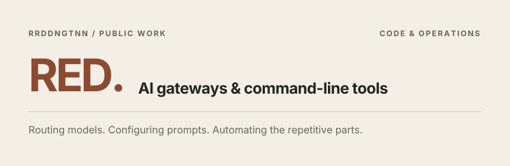
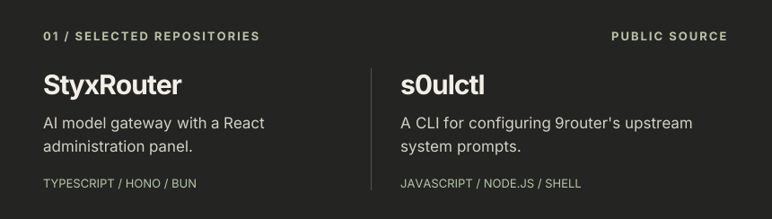
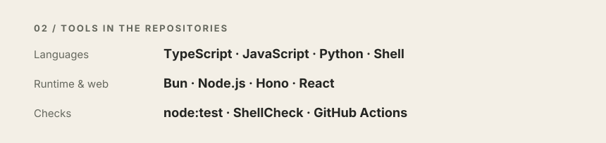

<!-- Original editorial design. CI owns README.md and .github/assets. -->

[StyxRouter →](https://github.com/rrddngtnn/styxrouter)   /   [s0ulctl →](https://github.com/rrddngtnn/s0ulctl)

Public GitHub data, refreshed daily. “Repo commits” counts default-branch repository history, not personal contributions.

[Browse repositories](https://github.com/rrddngtnn?tab=repositories) · [Profile source](https://github.com/rrddngtnn/rrddngtnn/blob/main/README.source.md)

Cards rendered with [readme-aura](https://github.com/collectioneur/readme-aura).
