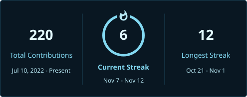

<!-- Independently authored visual reconstruction; see DESIGN.md and ATTRIBUTION.md. CI owns outputs. -->

<h3 align="center"><samp>&gt; Hey There!, I am <b><a href="https://github.com/rrddngtnn">Raymond REDdington</a></b></samp></h3>

 

<samp>「 Building AI model gateways, command-line tools, and automation 」</samp>

## Stats

## Languages

## Streak

## Achievements

