<!-- Independently authored visual reconstruction; see DESIGN.md and ATTRIBUTION.md. CI owns outputs. -->

<p align="center">

</p>

<h3 align="center"><samp>&gt; Hey There!, I am <b><a href="https://github.com/rrddngtnn">Raymond REDdington</a></b></samp></h3>

<br>

<p align="center">
<samp>「 Building AI model gateways, command-line tools, and automation 」</samp>
</p>

<p align="center">
<a href="https://github.com/rrddngtnn/styxrouter"></a> <a href="https://github.com/rrddngtnn/rrddngtnn"></a> <a href="https://github.com/rrddngtnn/s0ulctl"></a>
</p>

<p align="center">
</p>

<p align="center">
<a href="https://github.com/rrddngtnn?tab=repositories"><b>Projects</b></a> &nbsp;|&nbsp; <a href="#-technologies-projects-and-domains"><b>Stack</b></a> &nbsp;|&nbsp; <a href="https://github.com/rrddngtnn/styxrouter/issues"><b>Discussions</b></a>
</p>

<p align="center">
</p>

<p align="center">
</p>

<p align="center">
<a href="https://github.com/rrddngtnn?tab=repositories"></a>
</p>

<p align="center">
<a href="https://github.com/rrddngtnn/styxrouter"></a> <a href="https://github.com/rrddngtnn/s0ulctl"></a> <a href="https://github.com/rrddngtnn/gsuite-seatpool"></a>
</p>

<p align="center">
<a href="https://github.com/rrddngtnn?tab=repositories"></a>
</p>

<p align="center">

</p>

<p align="center">
</p>

<p align="center">

</p>

# 🛠 Technologies, Projects, and Domains

<table border="0" cellspacing="10" cellpadding="0"><tr>
<td width="420" valign="top" align="center">
<h3>🛠 Technologies</h3><br>
<table align="center" cellspacing="0" cellpadding="6">
<tr><td align="center"></td><td align="center"></td><td align="center"></td><td align="center"></td><td align="center"></td></tr>
<tr><td align="center"></td><td align="center"></td><td align="center"></td><td align="center"></td><td align="center"></td></tr>
<tr><td align="center"></td><td align="center"></td><td align="center"></td><td align="center"></td><td align="center"></td></tr>
<tr><td align="center"></td><td align="center"></td><td align="center"></td><td align="center"></td><td align="center"></td></tr>
<tr><td align="center"></td><td align="center"></td><td align="center"></td></tr>
</table>
</td>
<td width="260" valign="top" align="center"><h3>🧪 Projects</h3><br>
<a href="https://github.com/rrddngtnn?tab=repositories"></a></td>
<td width="260" valign="top" align="center"><h3>🧠 Domains</h3><br>
<a href="https://github.com/rrddngtnn/styxrouter"></a></td>
</tr></table>

<p align="center">
</p>

### 📊 Vital Statistics

```aura width=860 height=196 align=center
<div style={{width:'100%',height:'100%',display:'flex',alignItems:'center',justifyContent:'center',background:'#101820',border:'1px solid #435b60',borderRadius:8,fontFamily:'Inter'}}>
{[['Public repos',github.stats.totalRepos],['Stars',github.stats.totalStars],['Repo commits',github.stats.totalCommits]].map(function(row,i){return <div key={row[0]} style={{width:280,display:'flex',flexDirection:'column',alignItems:'center',gap:14,borderLeft:i?'1px solid #435b60':'none'}}><span style={{fontSize:44,fontWeight:700,color:row[1]?'#eab66a':'#a9b8b5'}}>{String(row[1])}</span><span style={{fontSize:16,color:'#edf0e8'}}>{row[0]}</span></div>;})}
</div>
```

```aura width=860 height=200 align=center
<div style={{display:'flex',flexDirection:'column',width:'100%',height:'100%',padding:28,background:'#19252f',borderRadius:8,border:'1px solid #435b60',fontFamily:'Inter'}}>
<span style={{fontSize:20,fontWeight:700,color:'#edf0e8'}}>Public repository languages</span>
<div style={{display:'flex',gap:18,marginTop:24}}>{github.languages.map(function(lang){return <div key={lang.name} style={{display:'flex',flexDirection:'column',gap:12,flex:1}}><span style={{fontSize:16,color:'#a9b8b5'}}>{lang.name}</span><span style={{fontSize:30,color:'#58b6a6',fontWeight:700}}>{String(lang.percentage)+'%'}</span></div>;})}</div>
<span style={{fontSize:12,color:'#a9b8b5',marginTop:22}}>Share of public repos by primary language · not lines of code</span>
</div>
```

<p align="center">
<sub>Live public GitHub data · daily refresh · no mock fallback</sub>
</p>

<p align="center">
<sub>Repo commits = default-branch repository history, not personal contributions.</sub>
</p>

<p align="center">
</p>

<table width="100%" border="0" cellspacing="10" cellpadding="0"><tr>
<td width="33%" valign="top"><h2>🤝 Collaboration</h2>
Project conversations around:<ul><li>AI model gateway integrations</li><li>Command-line tooling</li><li>Prompt configuration</li><li>Python automation utilities</li></ul></td>
<td width="34%" align="center" valign="middle"><a href="https://github.com/rrddngtnn/styxrouter/issues"></a></td>
<td width="33%" valign="top" align="center"><h2>📫 Contact</h2><br>
<a href="https://github.com/rrddngtnn"></a><br><br>
<a href="https://github.com/rrddngtnn/styxrouter/issues"></a><br><br>
<a href="https://github.com/rrddngtnn/s0ulctl/issues"></a><br><br>
</td></tr></table>

<p align="center">

</p>

<p align="center">
⚡ Building AI gateways, command-line tools, and automation
</p>

<p align="center">
Star ⭐ the repos if they helped you!
</p>

<p align="center">
<a href="https://github.com/rrddngtnn/styxrouter/blob/main/CONTRIBUTING.md">Contributing</a> · <a href="https://github.com/rrddngtnn/styxrouter/blob/main/SECURITY.md">Security</a> · <a href="./DESIGN.md">Design</a> · <a href="./ATTRIBUTION.md">Attribution</a> · <a href="./README.source.md">Source</a>
</p>

<p align="center">
<a href="https://github.com/rrddngtnn/rrddngtnn"></a>
</p>

<p align="center">

</p>
