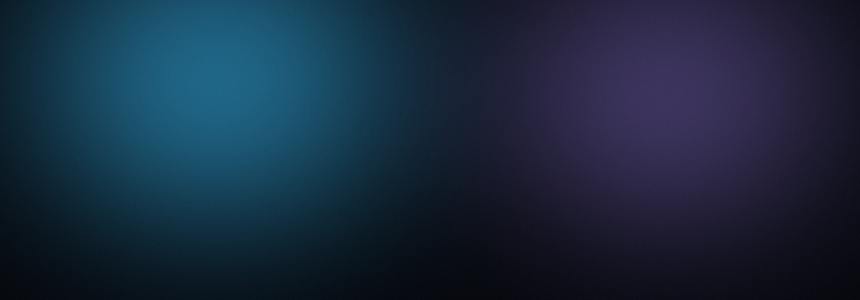

```aura width=860 height=300 link="https://github.com/rrddngtnn"
<div style={{
  width: '100%', height: '100%', background: '#06080d',
  display: 'flex', alignItems: 'center', fontFamily: 'Inter',
  position: 'relative', overflow: 'hidden', borderRadius: 16,
  border: '1px solid rgba(56,189,248,0.22)'
}}>
  

  <div style={{
    position: 'absolute', left: 85, top: 62, width: 176, height: 176,
    borderRadius: 88, background: 'linear-gradient(160deg, #38bdf8, #a78bfa)',
    display: 'flex', alignItems: 'center', justifyContent: 'center',
  }}>
    
  </div>

  <div style={{ display:'flex', flexDirection:'column', marginLeft:309, marginTop:0, gap:10 }}>
    <div style={{ display:'flex', fontSize:54, fontWeight:800, color:'#ffffff', letterSpacing:'-1.5px', lineHeight:1 }}>
      RED
    </div>
    <div style={{ display:'flex', fontSize:20, color:'rgba(226,236,248,0.92)', fontWeight:400, letterSpacing:'0.2px', lineHeight:1.35 }}>
      Systems · Runtime Patching · LLM Infrastructure
    </div>
  </div>
</div>
```

```aura width=860 height=172
(function() {
  var n = github.stats.totalRepos;
  var stats = [
    { label: n === 1 ? 'Public repo' : 'Public repos', value: String(n), color: '#38bdf8' },
    { label: 'Stars', value: String(github.stats.totalStars), color: '#8fa3bd' },
    { label: 'Commits', value: String(github.stats.totalCommits), color: '#a78bfa' },
  ];

  return (
    <div style={{
      width: '100%', height: '100%',
      background: '#06080d',
      display: 'flex', alignItems: 'center', justifyContent: 'center',
      fontFamily: 'Inter', borderRadius: 16,
      border: '1px solid rgba(56,189,248,0.22)',
      position: 'relative', overflow: 'hidden',
    }}>
  

      {stats.map(function(s, i) {
        return (
          <div key={s.label} style={{
            flexGrow: 1, alignSelf: 'stretch', display: 'flex', flexDirection: 'column',
            alignItems: 'center', justifyContent: 'center',
            padding: '18px 10px',
            borderRight: i < stats.length - 1 ? '1px solid rgba(255,255,255,0.08)' : 'none',
            gap: 8,
          }}>
            <div style={{ display:'flex', fontSize:46, fontWeight:800, color:s.color, lineHeight:1 }}>
              {s.value}
            </div>
            <div style={{ display:'flex', fontSize:13, color:'rgba(214,228,244,0.82)', fontWeight:600, letterSpacing:'1.6px' }}>
              {s.label.toUpperCase()}
            </div>
          </div>
        );
      })}
    </div>
  );
})()
```

```aura width=860 height=228
(function() {
  var topLangs = (github.languages || []).slice(0, 6).map(function(l) { return l.name; });
  if (topLangs.length === 0) topLangs = ['Shell', 'JavaScript', 'TypeScript'];
  var categories = [
    { title: 'Languages', color: '#38bdf8', items: ['Shell', 'TypeScript', 'JavaScript'] },
    { title: 'Environment', color: '#a78bfa', items: ['Linux', 'systemd', 'Node.js', 'Docker'] },
    { title: 'Tooling', color: '#22d3ee', items: ['git', 'gh', 'ripgrep', 'jq', 'tmux', 'nvim'] },
  ];

  return (
    <div style={{
      width: '100%', height: '100%',
      background: '#06080d',
      display: 'flex', flexDirection: 'column',
      fontFamily: 'Inter', padding: '28px 44px 28px', gap: 16,
      borderRadius: 16, border: '1px solid rgba(56,189,248,0.22)',
      position: 'relative', overflow: 'hidden',
    }}>
  

      <div style={{ display:'flex', fontSize:12, fontWeight:700, color:'rgba(180,205,232,0.75)', letterSpacing:'3.5px' }}>
        STACK
      </div>
      <div style={{ display:'flex', flexDirection:'column', gap:18 }}>
        {categories.map(function(cat) {
          return (
            <div key={cat.title} style={{ display:'flex', alignItems:'center', gap:16 }}>
              <div style={{ display:'flex', fontSize:12, fontWeight:700, color:'rgba(196,216,240,0.76)', letterSpacing:'1.4px', width:152 }}>
                {cat.title.toUpperCase()}
              </div>
              <div style={{ display:'flex', flexWrap:'wrap', gap:9 }}>
                {cat.items.map(function(item) {
                  return (
                    <div key={item} style={{
                      display:'flex', padding:'8px 18px', borderRadius:22,
                      background:'rgba(10,16,28,0.74)', border:'1px solid rgba(120,190,240,0.42)',
                      color:'rgba(230,242,252,0.96)', fontSize:14, fontWeight:600,
                    }}>{item}</div>
                  );
                })}
              </div>
            </div>
          );
        })}
      </div>
    </div>
  );
})()
```

```aura width=124 height=44 link="https://github.com/rrddngtnn" inline align=center
<SocialMediaButton
  icon="data:image/svg+xml;base64,PHN2ZyByb2xlPSJpbWciIHZpZXdCb3g9IjAgMCAyNCAyNCIgeG1sbnM9Imh0dHA6Ly93d3cudzMub3JnLzIwMDAvc3ZnIj48dGl0bGU+R2l0SHViPC90aXRsZT48cGF0aCBmaWxsPSIjZmZmZmZmIiBkPSJNMTIgLjI5N2MtNi42MyAwLTEyIDUuMzczLTEyIDEyIDAgNS4zMDMgMy40MzggOS44IDguMjA1IDExLjM4NS42LjExMy44Mi0uMjU4LjgyLS41NzcgMC0uMjg1LS4wMS0xLjA0LS4wMTUtMi4wNC0zLjMzOC43MjQtNC4wNDItMS42MS00LjA0Mi0xLjYxQzQuNDIyIDE4LjA3IDMuNjMzIDE3LjcgMy42MzMgMTcuN2MtMS4wODctLjc0NC4wODQtLjcyOS4wODQtLjcyOSAxLjIwNS4wODQgMS44MzggMS4yMzYgMS44MzggMS4yMzYgMS4wNyAxLjgzNSAyLjgwOSAxLjMwNSAzLjQ5NS45OTguMTA4LS43NzYuNDE3LTEuMzA1Ljc2LTEuNjA1LTIuNjY1LS4zLTUuNDY2LTEuMzMyLTUuNDY2LTUuOTMgMC0xLjMxLjQ2NS0yLjM4IDEuMjM1LTMuMjItLjEzNS0uMzAzLS41NC0xLjUyMy4xMDUtMy4xNzYgMCAwIDEuMDA1LS4zMjIgMy4zIDEuMjMuOTYtLjI2NyAxLjk4LS4zOTkgMy0uNDA1IDEuMDIuMDA2IDIuMDQuMTM4IDMgLjQwNSAyLjI4LTEuNTUyIDMuMjg1LTEuMjMgMy4yODUtMS4yMy42NDUgMS42NTMuMjQgMi44NzMuMTIgMy4xNzYuNzY1Ljg0IDEuMjMgMS45MSAxLjIzIDMuMjIgMCA0LjYxLTIuODA1IDUuNjI1LTUuNDc1IDUuOTIuNDIuMzYuODEgMS4wOTYuODEgMi4yMiAwIDEuNjA2LS4wMTUgMi44OTYtLjAxNSAzLjI4NiAwIC4zMTUuMjEuNjkuODI1LjU3QzIwLjU2NSAyMi4wOTIgMjQgMTcuNTkyIDI0IDEyLjI5N2MwLTYuNjI3LTUuMzczLTEyLTEyLTEyIi8+PC9zdmc+"
  text="GitHub"
  backgroundColor="#06080d"
  width={124}
  height={44}
  gradientStops={[
    { offset: '0%', color: '#38bdf8' },
    { offset: '30%', color: '#06080d' },
    { offset: '60%', color: '#7dd3fc' },
    { offset: '80%', color: '#06080d' },
    { offset: '100%', color: '#a78bfa' },
  ]}
/>
```

```aura width=112 height=44 link="https://x.com/YOUR_HANDLE" inline align=center
<SocialMediaButton
  icon="data:image/svg+xml;base64,PHN2ZyByb2xlPSJpbWciIHZpZXdCb3g9IjAgMCAyNCAyNCIgeG1sbnM9Imh0dHA6Ly93d3cudzMub3JnLzIwMDAvc3ZnIj48dGl0bGU+WDwvdGl0bGU+PHBhdGggZmlsbD0iI2ZmZmZmZiIgZD0iTTE0LjIzNCAxMC4xNjIgMjIuOTc3IDBoLTIuMDcybC03LjU5MSA4LjgyNEw3LjI1MSAwSC4yNThsOS4xNjggMTMuMzQzTC4yNTggMjRIMi4zM2w4LjAxNi05LjMxOEwxNi43NDkgMjRoNi45OTN6bS0yLjgzNyAzLjI5OS0uOTI5LTEuMzI5TDMuMDc2IDEuNTZoMy4xODJsNS45NjUgOC41MzIuOTI5IDEuMzI5IDcuNzU0IDExLjA5aC0zLjE4MnoiLz48L3N2Zz4="
  text="X.com"
  backgroundColor="#06080d"
  width={112}
  height={44}
  gradientStops={[
    { offset: '0%', color: '#a78bfa' },
    { offset: '30%', color: '#06080d' },
    { offset: '60%', color: '#38bdf8' },
    { offset: '80%', color: '#06080d' },
    { offset: '100%', color: '#7dd3fc' },
  ]}
/>
```

```aura width=134 height=44 link="https://t.me/YOUR_HANDLE" inline align=center
<SocialMediaButton
  icon="data:image/svg+xml;base64,PHN2ZyByb2xlPSJpbWciIHZpZXdCb3g9IjAgMCAyNCAyNCIgeG1sbnM9Imh0dHA6Ly93d3cudzMub3JnLzIwMDAvc3ZnIj48dGl0bGU+VGVsZWdyYW08L3RpdGxlPjxwYXRoIGZpbGw9IiNmZmZmZmYiIGQ9Ik0xMS45NDQgMEExMiAxMiAwIDAgMCAwIDEyYTEyIDEyIDAgMCAwIDEyIDEyIDEyIDEyIDAgMCAwIDEyLTEyQTEyIDEyIDAgMCAwIDEyIDBhMTIgMTIgMCAwIDAtLjA1NiAwem00Ljk2MiA3LjIyNGMuMS0uMDAyLjMyMS4wMjMuNDY1LjE0YS41MDYuNTA2IDAgMCAxIC4xNzEuMzI1Yy4wMTYuMDkzLjAzNi4zMDYuMDIuNDcyLS4xOCAxLjg5OC0uOTYyIDYuNTAyLTEuMzYgOC42MjctLjE2OC45LS40OTkgMS4yMDEtLjgyIDEuMjMtLjY5Ni4wNjUtMS4yMjUtLjQ2LTEuOS0uOTAyLTEuMDU2LS42OTMtMS42NTMtMS4xMjQtMi42NzgtMS44LTEuMTg1LS43OC0uNDE3LTEuMjEuMjU4LTEuOTEuMTc3LS4xODQgMy4yNDctMi45NzcgMy4zMDctMy4yMy4wMDctLjAzMi4wMTQtLjE1LS4wNTYtLjIxMnMtLjE3NC0uMDQxLS4yNDktLjAyNGMtLjEwNi4wMjQtMS43OTMgMS4xNC01LjA2MSAzLjM0NS0uNDguMzMtLjkxMy40OS0xLjMwMi40OC0uNDI4LS4wMDgtMS4yNTItLjI0MS0xLjg2NS0uNDQtLjc1Mi0uMjQ1LTEuMzQ5LS4zNzQtMS4yOTctLjc4OS4wMjctLjIxNi4zMjUtLjQzNy44OTMtLjY2MyAzLjQ5OC0xLjUyNCA1LjgzLTIuNTI5IDYuOTk4LTMuMDE0IDMuMzMyLTEuMzg2IDQuMDI1LTEuNjI3IDQuNDc2LTEuNjM1eiIvPjwvc3ZnPg=="
  text="Telegram"
  backgroundColor="#06080d"
  width={134}
  height={44}
  gradientStops={[
    { offset: '0%', color: '#7dd3fc' },
    { offset: '30%', color: '#06080d' },
    { offset: '60%', color: '#38bdf8' },
    { offset: '80%', color: '#06080d' },
    { offset: '100%', color: '#22d3ee' },
  ]}
/>
```

```aura width=110 height=44 link="mailto:you@example.com" inline align=center
<SocialMediaButton
  icon="data:image/svg+xml;base64,PHN2ZyByb2xlPSJpbWciIHZpZXdCb3g9IjAgMCAyNCAyNCIgeG1sbnM9Imh0dHA6Ly93d3cudzMub3JnLzIwMDAvc3ZnIj48dGl0bGU+R21haWw8L3RpdGxlPjxwYXRoIGZpbGw9IiNmZmZmZmYiIGQ9Ik0yNCA1LjQ1N3YxMy45MDljMCAuOTA0LS43MzIgMS42MzYtMS42MzYgMS42MzZoLTMuODE5VjExLjczTDEyIDE2LjY0bC02LjU0NS00LjkxdjkuMjczSDEuNjM2QTEuNjM2IDEuNjM2IDAgMCAxIDAgMTkuMzY2VjUuNDU3YzAtMi4wMjMgMi4zMDktMy4xNzggMy45MjctMS45NjRMNS40NTUgNC42NCAxMiA5LjU0OGw2LjU0NS00LjkxIDEuNTI4LTEuMTQ1QzIxLjY5IDIuMjggMjQgMy40MzQgMjQgNS40NTd6Ii8+PC9zdmc+"
  text="Email"
  backgroundColor="#06080d"
  width={110}
  height={44}
  gradientStops={[
    { offset: '0%', color: '#60a5fa' },
    { offset: '30%', color: '#06080d' },
    { offset: '60%', color: '#7dd3fc' },
    { offset: '80%', color: '#06080d' },
    { offset: '100%', color: '#38bdf8' },
  ]}
/>
```

<p align="center"><sub>𝗉𝗈𝗐𝖾𝗋𝖾𝖽 𝖻𝗒 <a href="https://github.com/collectioneur/readme-aura">𝗋𝖾𝖺𝖽𝗆𝖾-𝖺𝗎𝗋𝖺</a></sub></p>
